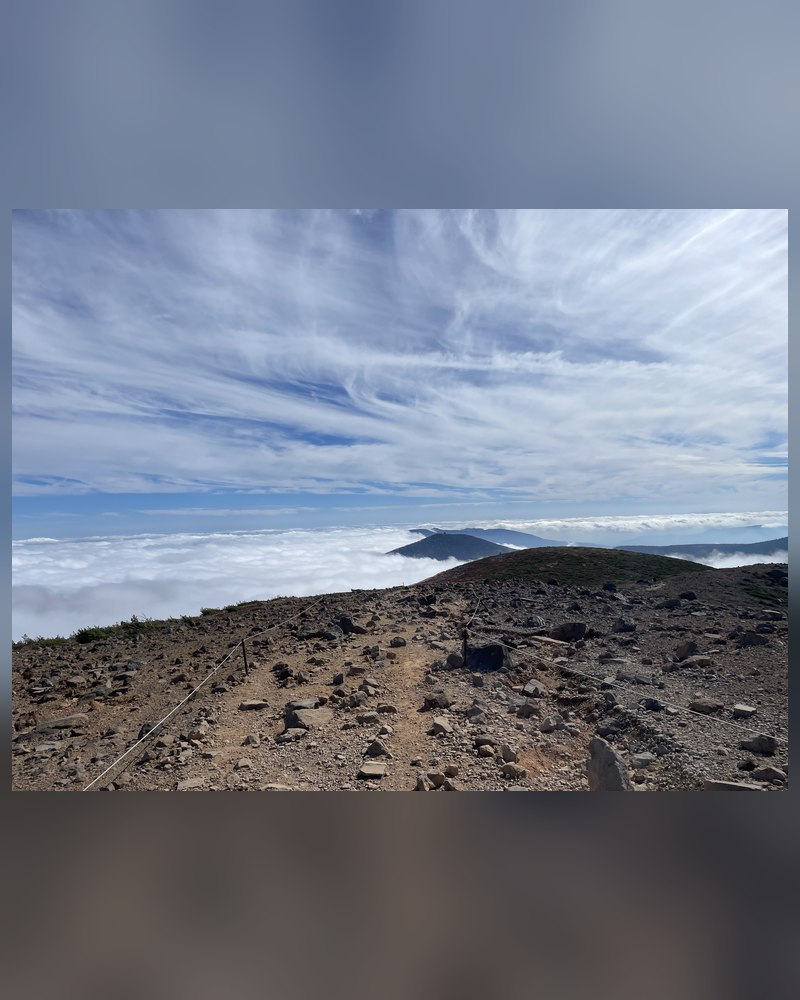
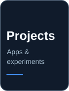

<!-- Transparent typing header. Desktop and mobile use purpose-built SVGs; no background. -->

  <picture>
    <source media="(max-width: 600px)" srcset="./assets/intro-mobile.svg">
    
  </picture>

<!-- Hero: a 3:2 photo and a 4:5 Spotify Compact card have matching displayed heights. -->

  
  &nbsp;
  

<!-- Compact navigation with no hyperlink underlines. -->

  
  &nbsp;&nbsp;
  

<!-- Hourly weather: kept centered, with no surrounding heading or paragraph margin. -->

  

<!-- Contribution visuals: no redundant headings and minimal section margins. -->

  <picture>
    <source media="(prefers-color-scheme: dark)" srcset="https://raw.githubusercontent.com/ryouy/ryouy/output/github-contribution-grid-snake-dark.svg">
    
  </picture>

  

