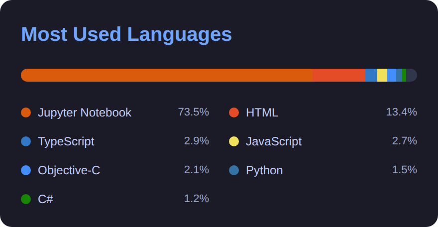

<table width="100%">
  <tr>
    <td width="42%" valign="middle">
      <strong>About</strong>
      
University of Aizu · Computer Science 
      Aizuwakamatsu → Azumino 
      Student / Developer / Artist / Hiker

      <strong>Exploring</strong>
      
LLMs &amp; Robotics · Art · World

      <strong>Interests</strong>
      
Philosophy · Economy · Future

      
<a href="https://ryouyplayground.vercel.app/#projects"><strong>View projects</strong></a> &nbsp;·&nbsp; <a href="https://www.youtube.com/@sun_voyager"><strong>YouTube</strong></a>

    </td>
    <td width="58%" valign="middle" align="right">
      
    </td>
  </tr>
</table>

<!-- Flexible card row: the cards sit side-by-side on desktops and wrap on narrow screens. -->

  
  

<!-- Full-width WakaTime graph: no unused second column underneath Spotify. -->

  

<!-- BEGIN ACTIVITY-GRAPH -->
<picture>
  <source media="(max-width: 767px)" srcset="activity-graph-mobile.svg">
  
</picture>
<!-- END ACTIVITY-GRAPH -->
