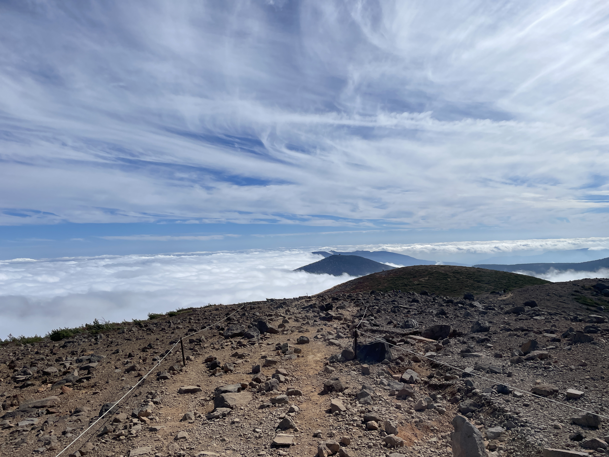
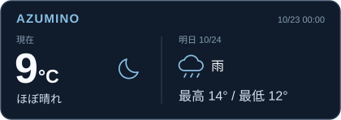
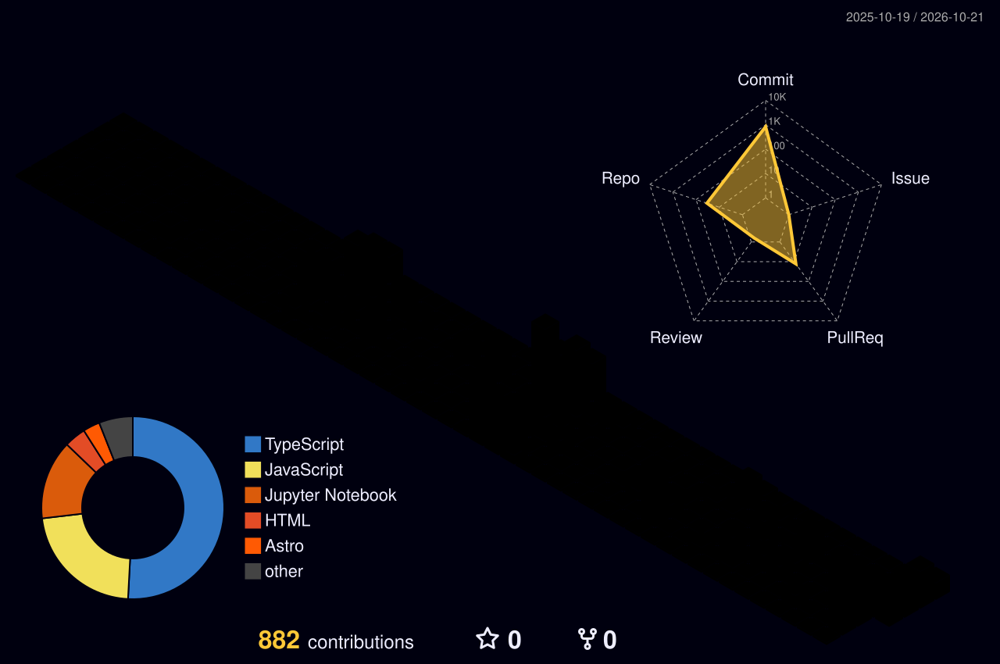

<!-- Typing SVG: About / Exploring / Interests -->

  

<!-- END PROFILE-EXTRAS -->

<!-- Simple, centered navigation. -->

  <a href="https://ryouyplayground.vercel.app/#projects"><strong>Projects</strong></a>
  &nbsp;&nbsp;&nbsp;·&nbsp;&nbsp;&nbsp;
  <a href="https://www.youtube.com/@sun_voyager"><strong>YouTube</strong></a>

<!-- Aligned portrait and Spotify card. Fixed pixel widths allow wrapping on narrow screens. -->

  
  &nbsp;
  

<!-- Compact, full-width weather strip. No standalone heading. -->

  

<!-- Animated GitHub contribution snake. Switches with GitHub's color scheme. -->

  <picture>
    <source media="(prefers-color-scheme: dark)" srcset="https://raw.githubusercontent.com/ryouy/ryouy/output/github-contribution-grid-snake-dark.svg">
    
  </picture>

<!-- 3D contribution calendar. Aligned to snake above. -->

  

