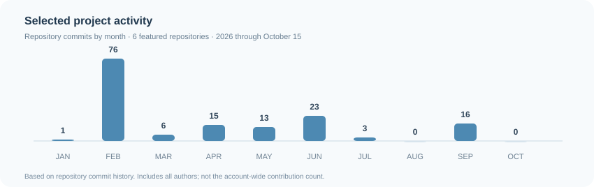

# Ryo Matsushita

Computer Science · University of Aizu, Japan

AI Research &nbsp; / &nbsp; Data Visualization &nbsp; / &nbsp; Software Engineering

## Activity

## Interests

**Research** &nbsp; LLM interpretability · Reasoning dynamics · Computational social science

**Visualization** &nbsp; Networks · Semantic embeddings · Interactive data exploration

**Engineering** &nbsp; AI applications · Full-stack development · VR / XR

## Projects

<table>
<tr>
<td width="132"></td>
<td><strong>Election 2026</strong> Interactive election survey visualization <a href="https://github.com/ryouy/election2026">Repository ↗</a> &nbsp;&nbsp; <a href="https://yomiuri-election-2026.web.app">Live app ↗</a></td>
</tr>
<tr>
<td width="132"></td>
<td><strong>gformgen</strong> Google Forms creation and response management <a href="https://github.com/ryouy/gformgen">Repository ↗</a> &nbsp;&nbsp; <a href="https://gfca-aizu.web.app">Live app ↗</a></td>
</tr>
<tr>
<td width="132"></td>
<td><strong>Human Topology</strong> Wikipedia relationship graph in 2D / 3D <a href="https://github.com/ryouy/human-topology">Repository ↗</a> &nbsp;&nbsp; <a href="https://human-topology.vercel.app">Live app ↗</a></td>
</tr>
<tr>
<td width="132"></td>
<td><strong>VR Project</strong> VR reflex game with hand tracking <a href="https://github.com/ryouy/VR_project">Repository ↗</a> &nbsp;&nbsp; <a href="https://unityroom.com/games/stick_catch">Live app ↗</a></td>
</tr>
<tr>
<td width="132"></td>
<td><strong>MindscapeAI</strong> LLM-powered semantic opinion maps <a href="https://github.com/ryouy/MindscapeAI">Repository ↗</a> &nbsp;&nbsp; <a href="https://mindscapeai.streamlit.app/">Live app ↗</a></td>
</tr>
<tr>
<td width="132"></td>
<td><strong>English as Code</strong> Visual English grammar and sentence structure <a href="https://github.com/ryouy/English_as_Code">Repository ↗</a></td>
</tr>
</table>

## Stack

`Python` &nbsp; `TypeScript` &nbsp; `JavaScript` &nbsp; `React` &nbsp; `Next.js` &nbsp; `PyTorch` &nbsp; `Unity` &nbsp; `Firebase`

---

<a href="https://ryouyplayground.vercel.app/">Website</a> &nbsp;·&nbsp; <a href="https://github.com/ryouy?tab=repositories">Repositories</a>
