<table>

<td width="34%" valign="middle">
  
**About**

University of Aizu · Computer Science 
Aizuwakamatsu → Azumino 
Student / Developer / Artist / Hiker

**Exploring** 

LLMs & Robotics · Art · World

**Interests**

Philosophy · Economy · Future

<a href="https://ryouyplayground.vercel.app/#projects"><strong>View projects</strong></a> &nbsp;·&nbsp; <a href="https://www.youtube.com/@sun_voyager"><strong>YouTube</strong></a>

</td>
<td width="46%" align="right" valign="middle">

</td>

</table>

<!-- BEGIN ACTIVITY-GRAPH -->
<picture>
  <source media="(max-width: 767px)" srcset="activity-graph-mobile.svg">
  
</picture>
<!-- END ACTIVITY-GRAPH -->
