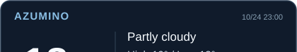

<!-- Transparent typing header. Desktop and mobile use purpose-built SVGs; no background. -->

  <picture>
    <source media="(max-width: 600px)" srcset="https://raw.githubusercontent.com/ryouy/ryouy/e2feef126edbb778c7e471ca707db8278124c412/assets/intro-mobile.svg">
    
  </picture>

<!-- 800px border-free grid: 534 + 10 + 256. Photo and Spotify both render at 356px. -->

<!-- Two flush half-panels form the weather and language cards. The independent links stay clickable. -->

<!-- Contribution visuals: no redundant headings and minimal section margins. -->
<!-- Custom contribution snakes, generated from the read-only upstream route data. -->

  <picture>
    <source media="(prefers-color-scheme: dark)" srcset="./assets/snake-duet-dark.svg?v=roaming-2">
    
  </picture>

