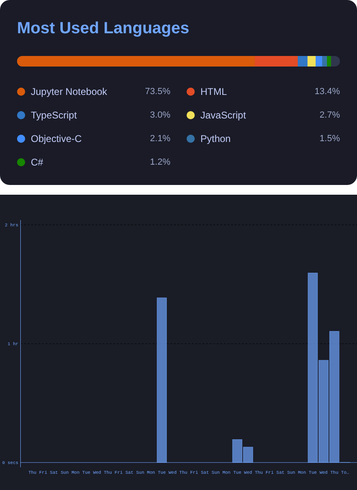

<!-- BEGIN PROFILE-EXTRAS -->
<!-- Animated header -->

  

<!-- Typing introduction -->

  

<!-- END PROFILE-EXTRAS -->

<!-- Borderless profile header: the photo floats right while text stays on the left. -->

**About**

University of Aizu · Computer Science 
Aizuwakamatsu → Azumino 
Student / Developer / Artist / Hiker

**Exploring**

LLMs & Robotics · Art · World

**Interests**

Philosophy · Economy · Future

[**Projects**](https://ryouyplayground.vercel.app/#projects)&nbsp;/&nbsp;[**YouTube**](https://www.youtube.com/@sun_voyager)

 

<!-- BEGIN LOCAL-WEATHER -->
**Weather · Aizuwakamatsu**

  

<!-- END LOCAL-WEATHER -->

<!-- Full-width, balanced cards. The equal-width images wrap onto separate lines on small screens. -->

  
  

<!-- BEGIN CONTRIBUTION-EXTRAS -->
**Contribution & Activity**

<!-- BEGIN ACTIVITY-GRAPH -->
<picture>
  <source media="(max-width: 767px)" srcset="activity-graph-mobile.svg">
  
</picture>
<!-- END ACTIVITY-GRAPH -->

<!-- Contribution snake: generated daily on the output branch -->

  <picture>
    <source media="(prefers-color-scheme: dark)" srcset="https://raw.githubusercontent.com/ryouy/ryouy/output/github-contribution-grid-snake-dark.svg">
    
  </picture>

<!-- 3D contribution calendar: generated daily in the main branch -->

  

<!-- END CONTRIBUTION-EXTRAS -->
