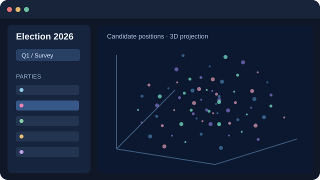
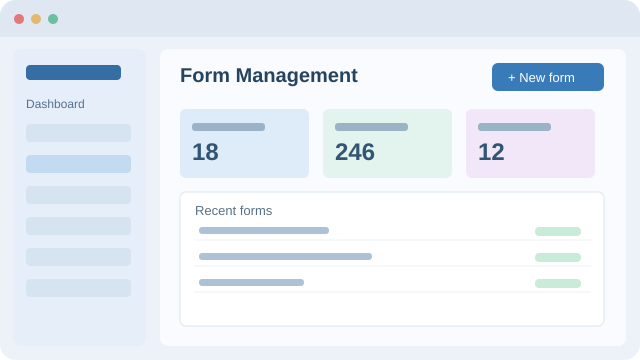
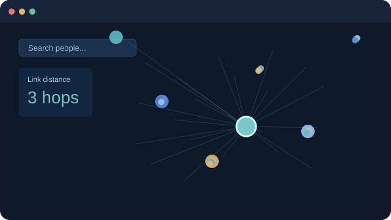
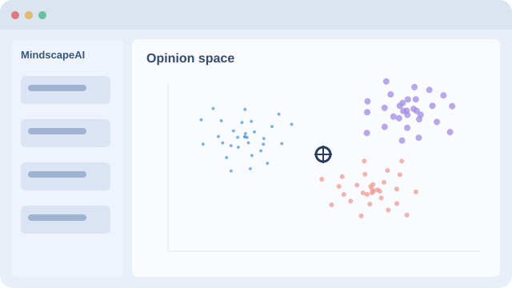
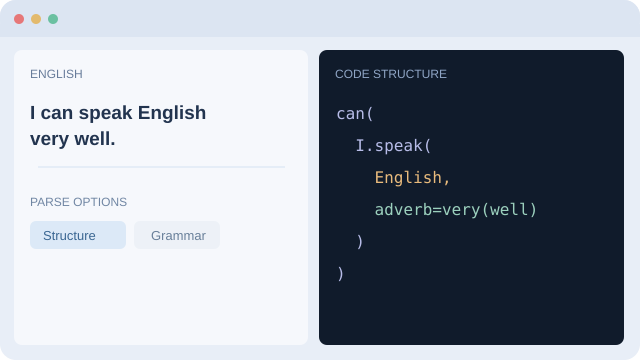

### About me

<table>
<tr>
<td width="66%" valign="middle">

I build small, thoughtful systems at the intersection of art, data, research, and the web.

**Affiliation** &nbsp; University of Aizu 
**Location** &nbsp; Aizuwakamatsu, Fukushima 
**Future base** &nbsp; Azumino, Nagano 
**Role** &nbsp; CS Student / Artist / Hiker

</td>
<td width="34%" align="right" valign="middle">

</td>
</tr>
</table>

**Skills** &nbsp; Data Analysis · Data Visualization · LLMs · Machine Learning · Python · TypeScript · React · Next.js · English · German

**Interests** &nbsp; Computational Social Science · Data Science · Hardware / Robotics · Art / Philosophy · Economics / Political Science · Hiking · Kendo

### Selected projects

<table>
<tr>
<td width="50%" valign="middle">

<strong>Election 2026</strong> 
Election survey in 3D 
 &nbsp;
</td>
<td width="50%" valign="middle">

<strong>gformgen</strong> 
Google Forms dashboard 
 &nbsp;
</td>
</tr>
<tr>
<td width="50%" valign="middle">

<strong>Human Topology</strong> 
Wikipedia people graph 
 &nbsp;
</td>
<td width="50%" valign="middle">

<strong>VR Project</strong> 
Hand-tracking VR game 
 &nbsp;
</td>
</tr>
<tr>
<td width="50%" valign="middle">

<strong>MindscapeAI</strong> 
LLM opinion-space explorer 
 &nbsp;
</td>
<td width="50%" valign="middle">

<strong>English as Code</strong> 
English syntax visualizer 

</td>
</tr>
</table>

### Languages

