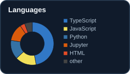

<!-- Transparent typing header. Desktop and mobile use purpose-built SVGs; no background. -->

  <picture>
    <source media="(max-width: 600px)" srcset="https://raw.githubusercontent.com/ryouy/ryouy/60aecbb61263fa672a59b1391d427fc8e698cad4/assets/intro-mobile.svg">
    
  </picture>

<!-- Aligned 800px grid: 534px photo / 256px Spotify, with 10px horizontal and vertical gutters.
     Both hero images are 356px tall at their natural aspect ratios.
     Weather and navigation cards share a 188.17px height. Keep tags adjacent
     so HTML whitespace cannot introduce uneven horizontal gutters. -->

<!-- Contribution visuals: no redundant headings and minimal section margins. -->

  <picture>
    <source media="(prefers-color-scheme: dark)" srcset="https://raw.githubusercontent.com/ryouy/ryouy/output/github-contribution-grid-snake-dark.svg">
    
  </picture>

<!-- Experimental duet is generated separately; keep the original snake above intact. -->

  <picture>
    <source media="(prefers-color-scheme: dark)" srcset="./assets/snake-duet-dark.svg?v=roaming-2">
    
  </picture>

  

