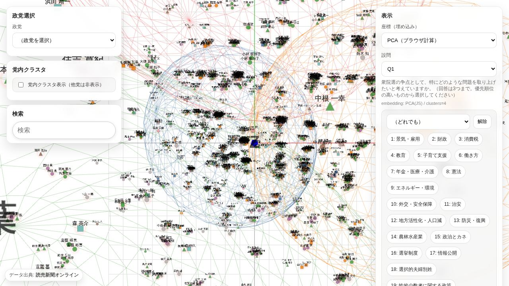
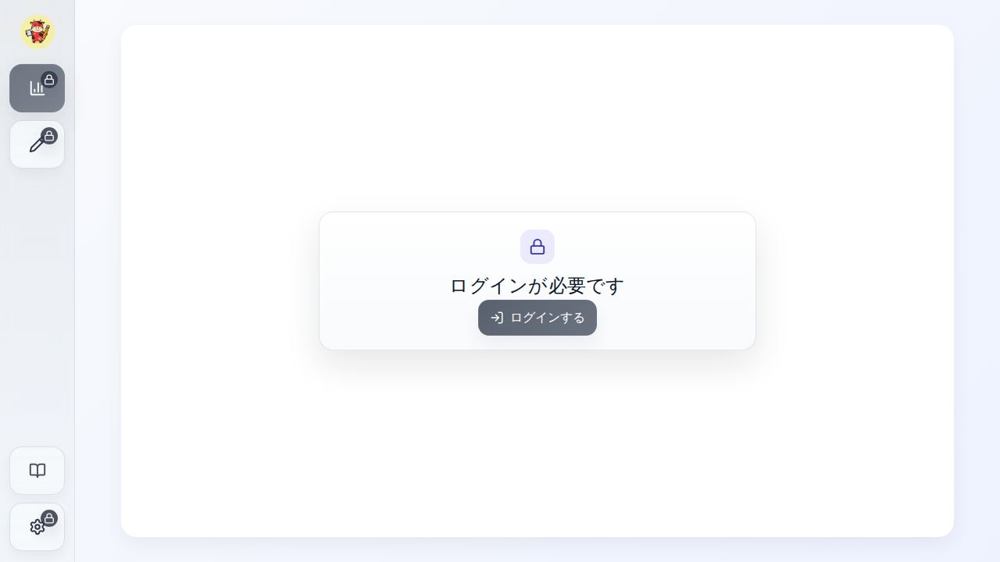
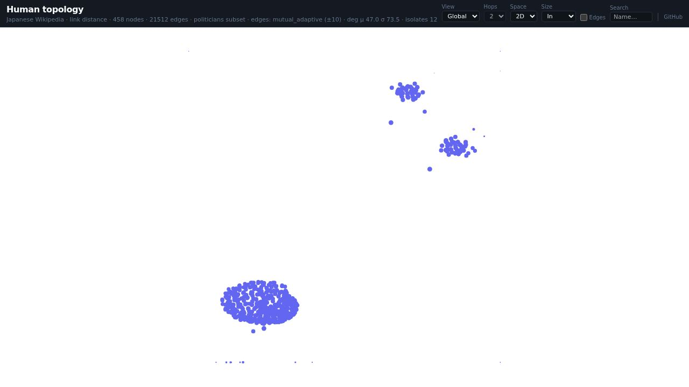
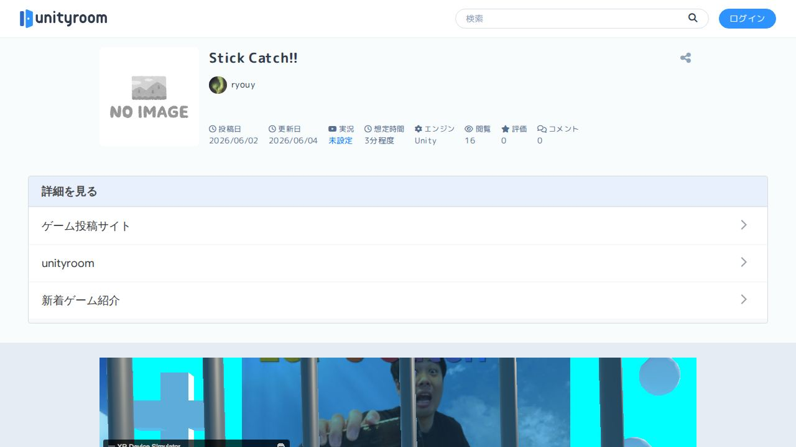
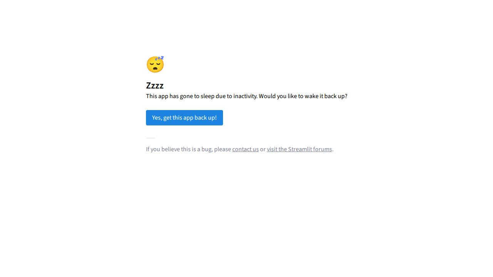
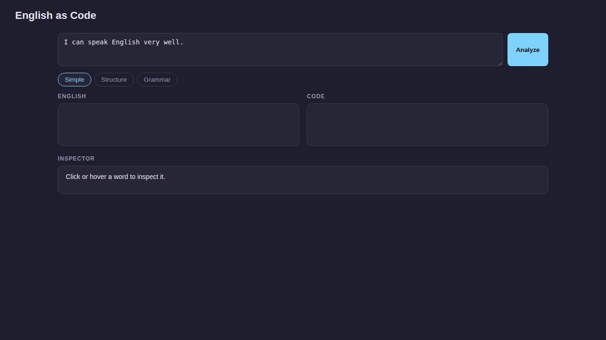

<table>
<tr>
<td width="63%" valign="middle">
<h3>About</h3>
<strong>University of Aizu</strong> · Aizuwakamatsu, Japan 
CS Student / Artist / Hiker 
Next base: Azumino, Nagano  

</td>
<td width="37%" align="right" valign="middle">

</td>
</tr>
</table>

**Focus** &nbsp; LLMs · Data visualization · Web development · Robotics

**Interests** &nbsp; Art · Philosophy · Economics · Hiking · Kendo

**Tools** &nbsp; Python · TypeScript · React · Next.js · PyTorch

### Work

<table>
<tr>
<td width="50%" valign="middle">

<strong>Election 2026</strong> 
Election data in 3D 
 &nbsp;
</td>
<td width="50%" valign="middle">

<strong>gformgen</strong> 
Google Forms manager 
 &nbsp;
</td>
</tr>
<tr>
<td width="50%" valign="middle">

<strong>Human Topology</strong> 
People & network graph 
 &nbsp;
</td>
<td width="50%" valign="middle">

<strong>VR Project</strong> 
Hand-tracking game 
 &nbsp;
</td>
</tr>
<tr>
<td width="50%" valign="middle">

<strong>MindscapeAI</strong> 
Visualizing LLM opinions 
 &nbsp;
</td>
<td width="50%" valign="middle">

<strong>English as Code</strong> 
English syntax explorer 
 &nbsp;
</td>
</tr>
</table>

### Languages

